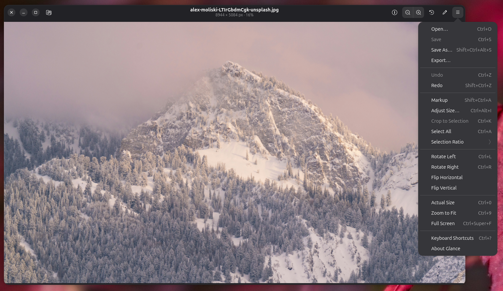

# Glance

**A quick image viewer and editor for GNOME, in the spirit of Preview on macOS.**
Open a picture, make the everyday fix (resize it, crop it, mark it up, convert it) and save it, without reaching for a
full paint program.

## What it does

- **View** images at the size of the window, or at 100% when they fit. Zoom with Ctrl+scroll or pinch, and step through the
  other images in the folder with ← and →. Transparent areas show on a checkerboard.
- **Adjust Size**: pixels, percent or print units, keep the proportions, change the resolution, choose the resampling,
  and see the resulting file size before you commit.
- **Crop** to a selection, freely or at a fixed ratio (1:1, 4:3, 16:9 or the original).
- **Rotate and flip** without losing quality until you save.
- **Export** to PNG, JPEG, WebP, AVIF¹, TIFF, GIF or BMP, with quality, transparency and background options, and an
  option to strip camera and location metadata.
- **Mark up** screenshots with rectangles, ovals, lines, arrows, highlights and text. Shapes stay editable (move,
  resize, recolour, change the font) until you move on to another kind of edit.
- **PDFs**: read them, and reorder, rotate, delete or insert pages, or merge PDFs by dropping them onto the sidebar.
- **Undo everything.** Nothing is written until you choose Save (which asks once before replacing the original) or
  Save As.

¹ AVIF when the Pillow build supports it; the Flatpak's does.

## Keyboard

Preview's shortcuts, with ⌘ as Ctrl:

| | |
|---|---|
| Open / Save / Save As | Ctrl+O / Ctrl+S / Ctrl+Shift+S |
| Undo / Redo | Ctrl+Z / Ctrl+Shift+Z |
| Zoom in / out / actual size / fit | Ctrl+= / Ctrl+− / Ctrl+0 / Ctrl+9 |
| Rotate left / right | Ctrl+L / Ctrl+R |
| Crop to selection | Ctrl+K |
| Adjust Size | Ctrl+Alt+I |
| Markup toolbar | Ctrl+Shift+A |
| Info | Ctrl+I |
| All shortcuts | Ctrl+? |

Mouse: drag to select (Shift for a square), drag the handles to adjust; scroll or middle-drag to pan.

## Install

Glance isn't on Flathub yet. To build and install the Flatpak from this repository (GNOME 51 runtime):

    flatpak install --user flathub org.gnome.Sdk//51 org.gnome.Platform//51
    flatpak-builder --user --install --force-clean flatpak-build io.github.kaibae19.Glance.json

If you'd rather not install `flatpak-builder` system-wide, Flathub's Builder app works too; it needs
`--disable-rofiles-fuse` inside its sandbox:

    flatpak install --user flathub org.flatpak.Builder
    flatpak run org.flatpak.Builder --user --install --disable-rofiles-fuse --force-clean \
        flatpak-build io.github.kaibae19.Glance.json

The Flatpak asks for access to your files (`--filesystem=host`) so that ← / → can step through a folder and Save can
write next to the original; the file chooser alone would only grant the one file you picked.

## Build from source

Needs GTK ≥ 4.12, libadwaita ≥ 1.5, PyGObject with Cairo support, Pillow, Poppler's GObject bindings, pypdf, meson,
blueprint-compiler and `glib-compile-resources`.

| Distro | Packages |
|---|---|
| Ubuntu 26.04 / Debian 13 | `python3-gi python3-gi-cairo gir1.2-gtk-4.0 gir1.2-adw-1 gir1.2-poppler-0.18 python3-pil python3-pypdf meson blueprint-compiler libglib2.0-dev-bin python3-pytest` |
| Fedora (untested) | `python3-gobject gtk4 libadwaita poppler-glib python3-pillow python3-pypdf meson blueprint-compiler python3-pytest` |
| Arch (untested) | `python-gobject gtk4 libadwaita poppler-glib python-pillow python-pypdf meson blueprint-compiler python-pytest` |

Then:

    scripts/dev [file…]     # build into _build, install into _install, and run
    meson test -C _build    # unit tests (no display needed), plus desktop file, metainfo and schema checks

## Development

The pixel and page logic (`document`, `ops`, `imageio`, `sizing`, `selection`, `markup`, `pdfdoc`) is plain Python
with pytest coverage that runs headless. The UI can be checked without a desktop session too:

    scripts/headless-shot out.png image.png   # screenshot in a throwaway headless GNOME Shell
    scripts/ui-smoke [dir]                    # drive the real window through each feature; screenshots in dir

Design notes and the reasoning behind the choices: [`docs/design.md`](docs/design.md).

Contributions are welcome: see [`CONTRIBUTING.md`](CONTRIBUTING.md). Security reports: [`SECURITY.md`](SECURITY.md).

## Status

1.0 covers images; PDF support is new (viewing and page operations). Not there yet: finding and selecting text in
PDFs, PDF annotations and signatures, password-protected PDFs, saving animated images, and Preview's fill colours and
extra shapes.

## License

GPL-3.0-or-later; see [`LICENSE`](LICENSE).
The photo in the screenshot is by Alex Moliski on Unsplash.
